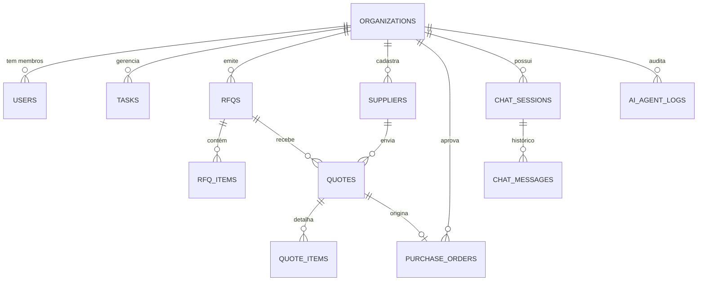

# 🗄️ Cooprail AI Procurement — Arquitetura de Banco de Dados

Este diretório contém a modelagem de dados relacional (PostgreSQL / Supabase) que sustenta todas as 4 fases do MVP da plataforma **Cooprail**.

---

## 📐 Diagrama de Entidade-Relacionamento (ERD)



---

## 🗂️ Mapeamento por Módulos da Plataforma

| Módulo / Fase | Tabelas Relacionadas | Propósito no MVP |
|---|---|---|
| **Fase 1: Fundação & Identidade** | `organizations`, `users`, `organization_members` | Multi-tenancy, perfis, branding de RFQs e organização ativa ("juliano's Organization"). |
| **Fase 2: Gestão de Decisões** | `tasks` | Dashboard com abas: *"Precisa de você"*, *"Aguardando outras pessoas"* e *"Concluído"*. |
| **Fase 3: Core de Compras** | `rfqs`, `rfq_items`, `suppliers`, `quotes`, `quote_items`, `purchase_orders`, `attachments` | Ciclo completo de compras: emissão de RFQ, cotações com score de IA, comparação e POs. |
| **Fase 4: Copiloto & Agentes IA** | `chat_sessions`, `chat_messages`, `ai_agent_logs` | Chat com suporte a Slash Commands (`/rfq`, `/compare`), histórico e logs de execução dos agentes. |

---

## 🚀 Opções Rápidas para Deploy Online

### Opção 1: Supabase (Mais recomendada para MVP rápido)
1. Crie um projeto gratuito em [supabase.com](https://supabase.com).
2. Abra o **SQL Editor** do Supabase.
3. Copie e execute o conteúdo de [`schema.sql`](./schema.sql).
4. Copie e execute o conteúdo de [`seed.sql`](./seed.sql).
5. O banco estará 100% online, com endpoints REST/GraphQL instantâneos e suporte a Storage para os PDFs de cotação.

### Opção 2: Neon ou Railway (PostgreSQL Gerenciado)
1. Crie uma instância PostgreSQL no [Neon.tech](https://neon.tech) ou [Railway.app](https://railway.app).
2. Obtenha a connection string (`DATABASE_URL`).
3. Execute:
   ```bash
   psql "$DATABASE_URL" -f database/schema.sql
   psql "$DATABASE_URL" -f database/seed.sql
   ```
